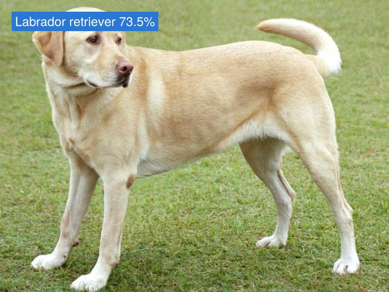
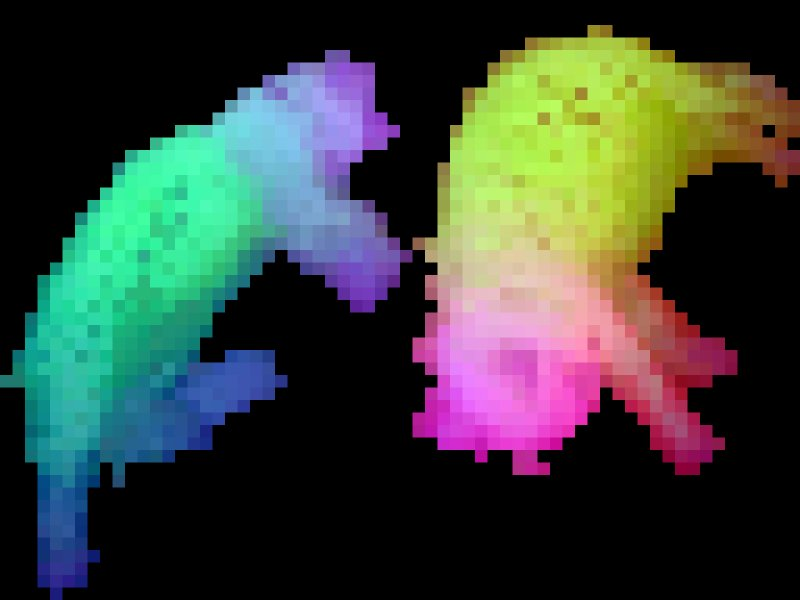
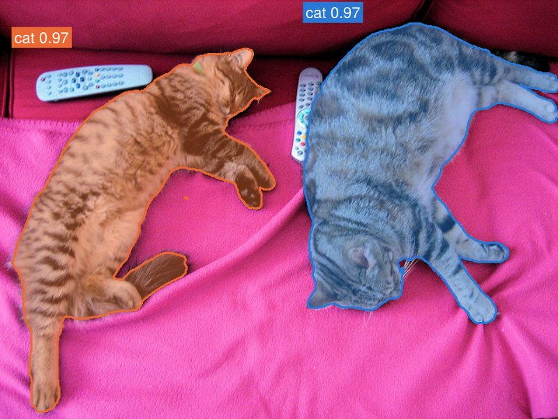

# Metalhead

[](https://fluxml.github.io/Metalhead.jl/dev)
[](https://github.com/FluxML/Metalhead.jl/actions/workflows/CI.yml)
[](https://codecov.io/gh/FluxML/Metalhead.jl)

Metalhead.jl brings pretrained models from the [Hugging Face Hub](https://huggingface.co/models)
to [Flux.jl](https://fluxml.ai), **in pure Julia**: about 300 vision models from
[timm](https://github.com/huggingface/pytorch-image-models); the language models Llama, Qwen,
Gemma 3 and Granite, the vision-language models Qwen3.5 and Qwen3.8 and the segmentation
model SAM 3 from [transformers](https://github.com/huggingface/transformers); and the pipeline
FLUX.2 [klein] from [diffusers](https://github.com/huggingface/diffusers), which generates and
edits images.

| [](https://fluxml.ai/Metalhead.jl/dev/tutorials/vision/) | [](https://fluxml.ai/Metalhead.jl/dev/tutorials/vision/) | [](https://fluxml.ai/Metalhead.jl/dev/tutorials/segmentation/) | [](https://fluxml.ai/Metalhead.jl/dev/tutorials/text_to_image/) |
|:--:|:--:|:--:|:--:|
| **Classify** images with timm's models | **Extract features** for new tasks: DINOv2's patches | **Segment** the objects a prompt names, with SAM 3 | **Generate** and edit images from text with FLUX.2 [klein] |

- **Pure Julia.** Each model is a port of the PyTorch original to Julia, built from Flux
  layers, and so is everything around it: downloading the weights from the Hub, preparing
  images, decoding masks, the sampling loop of a diffusion pipeline. Neither PyTorch nor
  Python is involved, except to tokenize text: the tokenizers of text models come from
  [HuggingFaceTokenizers.jl](https://github.com/MurrellGroup/HuggingFaceTokenizers.jl),
  which calls Hugging Face's tokenizers library through Python.
- **Ordinary Flux models.** A model is a Flux model like any other: differentiable, ready
  for inference or fine-tuning, on the CPU or a GPU, and its fields have the names of the
  PyTorch submodules.
- **Any Hub checkpoint.** `create_model` downloads a repository's configuration and
  safetensors weights, and builds its architecture; `create_processor` loads the processor
  of the same repository, which turns images, text and boxes into the inputs of the model,
  and its outputs back into results.
- **[Validated against PyTorch](https://fluxml.ai/Metalhead.jl/dev/validation/).** A small,
  randomly initialised version of each architecture matches PyTorch's float64 outputs to a
  relative error of 1e-8, in CI and without Python; real checkpoints match to 1e-4 in
  float32 (1e-3 after the denoising steps of FLUX.2); weights load by name, strictly. The processors match those of the Python
  libraries too, bit for bit on 8-bit images.

## Installation

Metalhead.jl requires Julia 1.10 or later. Install it from the Julia package manager:

```julia
julia> ]add Metalhead
```

## Quick tour

Classify an image:

```julia
using Metalhead, Flux, FileIO, ImageCore

model = create_model("timm/convnext_tiny.fb_in1k")           # with its pretrained weights
transform = create_processor("timm/convnext_tiny.fb_in1k")   # timm's eval transform

x = transform(load("dog.jpg"))   # 224 × 224 × 3 × 1: width × height × channels × batch
probs = softmax(model(x))        # 1000 × 1
```

Continue a text, with the tokenizer of the repository, which
[HuggingFaceTokenizers.jl](https://github.com/MurrellGroup/HuggingFaceTokenizers.jl) runs:

```julia
import HuggingFaceTokenizers as HFT

model = create_model("HuggingFaceTB/SmolLM2-135M")
tok = create_processor("HuggingFaceTB/SmolLM2-135M")

logits = model(tok("The capital of France is the city of"))
HFT.decode(tok, argmax(logits[:, end]))   # " Paris"
```

Segment the objects that a text names:

```julia
model = create_model("unsloth/sam3.1")
proc = create_processor("unsloth/sam3.1")

inputs = proc(; images = load("cats.jpg"), text = "a cat")
objects = only(post_process_instance_segmentation(proc, model(inputs); threshold = 0.5,
    target_sizes = inputs.original_sizes))   # the scores, boxes and masks of the cats
```

Generate an image on a GPU, and edit it:

```julia
using CUDA, cuDNN

pipe = gpu(create_model("black-forest-labs/FLUX.2-klein-4B"; eltype = BFloat16))
image = pipe("A photo of a red fox sitting in fresh snow"; num_inference_steps = 4)
save("fox.png", Metalhead.image_matrix(cpu(image))[1])
edited = pipe("Make it night, under the northern lights"; image = load("fox.png"),
    num_inference_steps = 4)
```

The [getting started guide](https://fluxml.ai/Metalhead.jl/dev/tutorials/quickstart/)
explains models, processors and the feature interface, and the tutorials cover
[vision models](https://fluxml.ai/Metalhead.jl/dev/tutorials/vision/),
[language models](https://fluxml.ai/Metalhead.jl/dev/tutorials/language_models/),
[vision-language models](https://fluxml.ai/Metalhead.jl/dev/tutorials/vision_language/),
[segmentation](https://fluxml.ai/Metalhead.jl/dev/tutorials/segmentation/) and
[text-to-image generation](https://fluxml.ai/Metalhead.jl/dev/tutorials/text_to_image/).

## Models

| Library | Ported families |
|:--|:--|
| [timm](https://github.com/huggingface/pytorch-image-models) | ResNet, ResNeXt, Wide ResNet, SE- and ECA-ResNet, Res2Net, ConvNeXt, DenseNet, VGG, Inception, Inception-ResNet, Xception, EfficientNet and EfficientNetV2, MobileNetV1 to V4, MNASNet, MixNet, FBNet, LCNet, ConvMixer, MLP-Mixer, ResMLP, gMLP, and ViT with the image encoders of DINOv2, CLIP and SigLIP |
| [transformers](https://github.com/huggingface/transformers) | Llama, Qwen2 and Qwen3, Gemma 3, and Granite, with its mixtures of experts and the Granite 4.0 models without Mamba layers; Qwen3.5 and Qwen3.8, vision-language models; SAM 3 and SAM 3.1, which segment the objects that a prompt describes |
| [diffusers](https://github.com/huggingface/diffusers) | FLUX.2 [klein]: the pipeline of text-to-image generation and image editing, its transformer and its autoencoder |

The [list of models](https://fluxml.ai/Metalhead.jl/dev/models/) gives each architecture of
these families and the Hub checkpoints whose outputs were compared with PyTorch's. Other Hub
repositories of the same architectures load too. From Julia:

```julia
list_models()                             # the ported architectures
list_models(; pretrained = true)          # the validated checkpoints
list_models(; byfamily = true)["resnet"]  # the architectures of a family
```

Metalhead ports what a checkpoint determines, such as its preprocessing, but not the
general-purpose machinery of the Python libraries: see its
[scope](https://fluxml.ai/Metalhead.jl/dev/scope/).

## Contributing

New models are ported with the tools in
[`porting/`](https://github.com/FluxML/Metalhead.jl/tree/master/porting) and a
[Claude Code](https://claude.com/claude-code) skill that takes an agent through a port and its
validation. See [Porting a model](https://fluxml.ai/Metalhead.jl/dev/contributing/).

## Upgrading from Metalhead 0.9

Metalhead 0.10 deprecates the hand-written models (`ResNet(50)`, `ViT(:base)`, ...), the
`Metalhead.Layers` module and `pretrain = true`. They will be removed in 0.11. The
[migration guide](https://fluxml.ai/Metalhead.jl/dev/migration/) gives the `create_model`
equivalent of each model.

## Acknowledgements

Metalhead's ports translate the code of three Hugging Face libraries, and its tests compare
against their outputs: [timm](https://github.com/huggingface/pytorch-image-models) (PyTorch
Image Models), by Ross Wightman and the Hugging Face team, and
[transformers](https://github.com/huggingface/transformers) and
[diffusers](https://github.com/huggingface/diffusers), by the Hugging Face team and their
contributors. The pretrained weights and their configurations are those of the Hub
repositories, published by timm or by each model's authors, and keep the license of their
repository.

Porting models with AI agents, loading the Hub weights by name and checking the result
against PyTorch, follows [Luximm.jl](https://github.com/csvance/Luximm.jl) by Carroll Vance,
which does the same for timm in [Lux.jl](https://lux.csail.mit.edu).

Before the ports, Metalhead was a collection of hand-written Flux models.
[Mike Innes](https://github.com/MikeInnes) started it in 2018, with
[Avik Pal](https://github.com/avik-pal), and [Dhairya Gandhi](https://github.com/DhairyaLGandhi)
and [Kyle Daruwalla](https://github.com/darsnack) maintained it through the following years.
[Abhirath Anand](https://github.com/theabhirath) wrote most of the
models and layers of Metalhead 0.9, and [Brian Chen](https://github.com/ToucheSir) kept its
tests running on CPUs and GPUs. [Carlo Lucibello](https://github.com/CarloLucibello) ported
the pretrained weights of torchvision to the Hugging Face Hub in 2023, has maintained
Metalhead since, and rebuilt it around ports of Hub models in Metalhead 0.10. Many
[other contributors](https://github.com/FluxML/Metalhead.jl/graphs/contributors) added models,
fixes and documentation.
