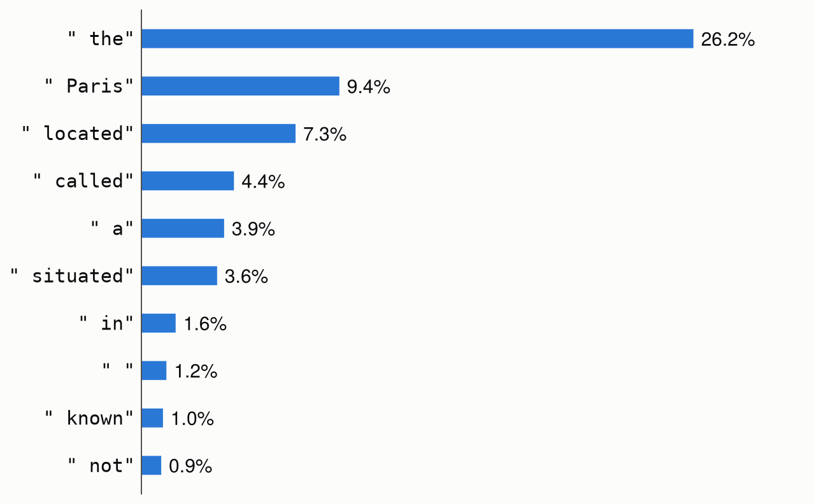

# [Language models](@id language_models)

Metalhead also ports language models from
[Hugging Face Transformers](https://github.com/huggingface/transformers), starting with the
Llama, Qwen, Gemma 3 and Granite architectures (`LlamaForCausalLM`, `Qwen2ForCausalLM`,
`Qwen3ForCausalLM`, `Qwen3_5ForCausalLM`, `Gemma3ForCausalLM`, `GraniteForCausalLM`,
`GraniteMoeForCausalLM`, `GraniteMoeSharedForCausalLM` and `GraniteMoeHybridForCausalLM`),
and the Qwen3.5 models that also read images, `Qwen3_5ForConditionalGeneration` (see
[Vision-language models](@ref vision_language)). They load from the Hub like the timm
models:

```julia
using Metalhead

model = create_model("HuggingFaceTB/SmolLM2-135M")
```

Any Hub repository whose `config.json` names a ported architecture loads, with the same strict
checks. See the [list of models](@ref models) for the architectures and the checkpoints they
were validated against.

## Generating text

Metalhead ports no tokenizer: the tokenizer of a repository is a `Tokenizer` of
[HuggingFaceTokenizers.jl](https://github.com/MurrellGroup/HuggingFaceTokenizers.jl), which
calls Hugging Face's tokenizers library through Python on the repository's
`tokenizer.json`. Install it with `Pkg.add("HuggingFaceTokenizers")`. With it loaded,
[`create_processor`](@ref) loads the processor of a model, a
[`TextProcessor`](@ref Metalhead.TextProcessor) of its tokenizer, at the revision of its
weights:

```julia
using HuggingFaceTokenizers

tok = create_processor("HuggingFaceTB/SmolLM2-135M")

prompt = "The capital of France is Paris, and the capital of Italy is"
ids = tok(prompt).input_ids                       # the token indices of the prompt
for _ in 1:8                                      # greedy decoding
    push!(ids, argmax(model(ids)[:, end]))
end
println(decode(tok, ids))
```

```
The capital of France is Paris, and the capital of Italy is Rome.

The capital of the
```

Token indices start at 1, as for Flux's `Embedding`, and the index of a logit is that of its
token: the processor gives token indices, and `decode(tok, indices)` takes them, as in
`decode(tok, argmax(logits[:, end]))`. The tokenizer itself, `tok.tokenizer`, gives and
takes the token ids of Hugging Face, which start at 0.

The tokenizer is that of `tokenizer.json`, with the padding token (`pad_token`) of
`tokenizer_config.json`. transformers reads the other settings of `tokenizer_config.json`
too, such as `add_bos_token`, which `create_processor` doesn't.

There is no key-value cache yet, so each step of this loop runs the model on the whole
sequence.

The logits of the last position give the probabilities of the next token:

```julia
using Flux: softmax

p = softmax(model(tok("The capital of France is"))[:, end])
top = sortperm(p; rev = true)[1:10]
[(decode(tok, i), p[i]) for i in top]   # (" the", 0.262), (" Paris", 0.094), ...
```



*The ten most probable tokens to follow "The capital of France is", for SmolLM2-135M. Greedy
decoding takes the first; sampling takes each with its probability.*

## Batches

The processor pads texts of different lengths on the right into a batch, with an
`attention_mask` that is 0 for the padding, and the model takes them as they are:

```julia
inputs = tok(["The capital of France is", "Hello"])
size(inputs.input_ids)          # (5, 2)
inputs.attention_mask           # [1 1; 1 0; 1 0; 1 0; 1 0]
logits = model(inputs)          # 49152 × 5 × 2
```

The padding takes no part in the attention of the other tokens, so its token doesn't matter,
and the logits of each text are those it has alone, at the positions of its tokens, up to
rounding. The processor pads with the padding token of the tokenizer, or, for a tokenizer
without one, such as SmolLM2's, with the token index 1.

## Inputs and outputs

- `model(ids)` takes token indices of size `(seq_len, batch_size)`, or a vector for a single
  sequence, and returns logits of size `(vocab_size, seq_len, batch_size)` (or
  `(vocab_size, seq_len)`).
- Attention is causal. Sequences of different lengths are batched by padding them on the right
  and passing the `attention_mask`, of size `(seq_len, batch_size)`, as a keyword argument:
  `model(ids; attention_mask)`. The padding takes no part in the attention of the other
  tokens. `model(inputs)` takes both from the output of the processor.
- [`forward_features`](@ref) returns the hidden states after the final norm, of size
  `(hidden_size, seq_len, batch_size)`, and [`forward_head`](@ref) applies the output
  projection `lm_head` to them.
- [`forward_intermediates`](@ref) returns the hidden states of the decoder layers, which
  diffusion models such as FLUX.2 use as text embeddings. It takes token indices, or the
  output of the processor, such as the batch above:
  `forward_intermediates(model, inputs; indices = [9, 18, 27], intermediates_only = true)`.
  The `i`-th is transformers' `output_hidden_states[i]`, and [`feature_info`](@ref) gives
  the size and the module of each layer.
- The weights are converted to `eltype` (`Float32` by default) when they are loaded, whatever
  their type on the Hub (often `bfloat16`).

## Configuration

The keyword arguments of `create_model` are the fields of the model's `config.json`, with the
names and defaults of transformers. With a repository, they override its configuration:

```julia
create_model("HuggingFaceTB/SmolLM2-135M"; pretrained = false, num_hidden_layers = 4)   # random weights
create_model("LlamaForCausalLM"; vocab_size = 1000, hidden_size = 64, intermediate_size = 128,
    num_hidden_layers = 2, num_attention_heads = 4, num_key_value_heads = 2)
```

The rotary embeddings are the default ones, or those scaled as in Llama 3.1 and later
(`rope_type = "llama3"`) or linearly (`"linear"`). Options that the ports don't implement raise
an error. These are the other rotary embeddings, such as `"yarn"`, and the sliding-window
attention of Qwen2 and Qwen3 (`use_sliding_window`, for the layers past
`max_window_layers`), which their released checkpoints leave off. Gemma 3 does have sliding-window attention: its layers attend either to all the previous
tokens or to the last `sliding_window` of them, as its `layer_types` say. Granite 4.0
(`GraniteMoeHybridForCausalLM`) loads only without its Mamba layers, as `granite-4.0-350m`
and `granite-4.0-1b` are; the `-h-` models have them.

transformers derives the Qwen2 and Qwen3 classes from Llama's, and their ports reuse the
Llama structs: a Qwen2 or Qwen3 model is a `LlamaForCausalLM`, whose Qwen3 attention layers
are `Qwen3Attention`s. Qwen3.5 has its own `Qwen3_5ForCausalLM`, whose layers have either a
gated delta rule (`Qwen3_5GatedDeltaNet`) or attention. A Gemma 3 model is a `Gemma3ForCausalLM` whose decoder is a `LlamaModel` of
`Gemma3DecoderLayer`s, and the four Granite classes are `GraniteForCausalLM`s.

## Mixtures of experts

In Granite MoE (`GraniteMoeForCausalLM`, and `GraniteMoeSharedForCausalLM` with a shared
expert), the MLP of each layer is a sparse mixture of experts: a router picks the
`num_experts_per_tok` experts of each token, whose outputs are summed with the router's
weights. Each projection of the experts is one `batched_mul` over the tokens grouped by
expert, so the experts compute only for their own tokens, as in transformers. Grouping the
tokens by expert copies the experts of each token to the CPU, once per layer on a GPU. The
load-balancing loss of training is not implemented.
