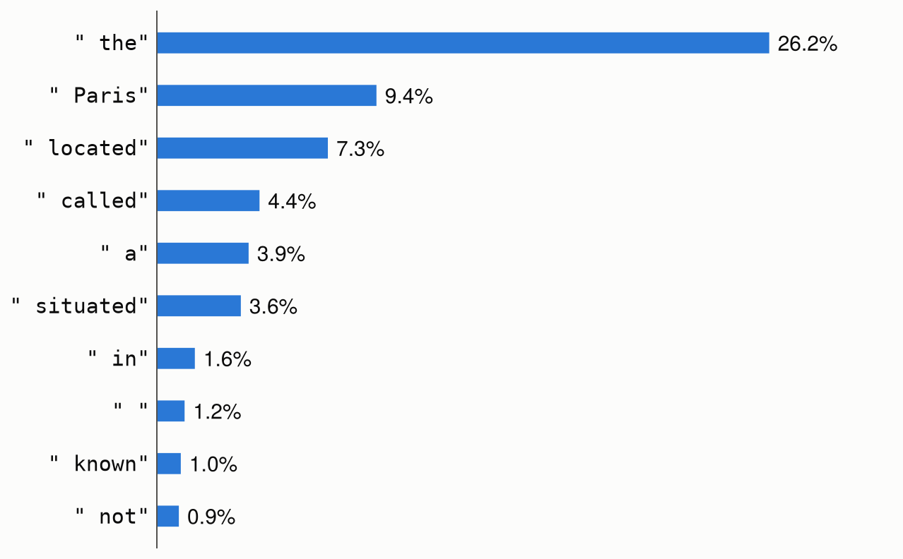

# [Language models](@id language_models)

Metalhead also ports language models from
[Hugging Face Transformers](https://github.com/huggingface/transformers), starting with the
Llama, Qwen, Gemma 3 and Granite architectures (`LlamaForCausalLM`, `Qwen2ForCausalLM`,
`Qwen3ForCausalLM`, `Qwen3MoeForCausalLM`, `Qwen3_5ForCausalLM`, `Qwen3_5MoeForCausalLM`,
`Gemma3ForCausalLM`, `GraniteForCausalLM`, `GraniteMoeForCausalLM`,
`GraniteMoeSharedForCausalLM` and `GraniteMoeHybridForCausalLM`), and the Qwen3.5 models that
also read images, `Qwen3_5ForConditionalGeneration` and `Qwen3_5MoeForConditionalGeneration`
(see [Vision-language models](@ref vision_language)). They load from the Hub like the timm
models:

```julia
using Metalhead

model = create_model("HuggingFaceTB/SmolLM2-135M")
```

Any Hub repository whose `config.json` names a ported architecture loads, with the same strict
checks. See the [list of models](@ref models) for the architectures and the checkpoints they
were validated against.

## Generating text

Metalhead ports no tokenizer: the tokenizer of a repository is a `Tokenizer` of
[HuggingFaceTokenizers.jl](https://github.com/MurrellGroup/HuggingFaceTokenizers.jl), which
calls Hugging Face's tokenizers library through Python on the repository's
`tokenizer.json`. Install it with `Pkg.add("HuggingFaceTokenizers")`. With it loaded,
[`create_processor`](@ref) loads the processor of a model, a
[`TextProcessor`](@ref Metalhead.TextProcessor) of its tokenizer, at the revision of its
weights:

```julia
using HuggingFaceTokenizers

tok = create_processor("HuggingFaceTB/SmolLM2-135M")

prompt = "The capital of France is Paris, and the capital of Italy is"
new = generate(model, tok(prompt); max_new_tokens = 8)   # the token indices of 8 new tokens
println(prompt, decode(tok, new))
```

```
The capital of France is Paris, and the capital of Italy is Rome.

The capital of the
```

Token indices start at 1, as for Flux's `Embedding`, and the index of a logit is that of its
token: the processor gives token indices, and `decode(tok, indices)` takes them, as in
`decode(tok, argmax(logits[:, end]))`. The tokenizer itself, `tok.tokenizer`, gives and
takes the token ids of Hugging Face, which start at 0.

The tokenizer is that of `tokenizer.json`, with the padding token (`pad_token`) of
`tokenizer_config.json`. transformers reads the other settings of `tokenizer_config.json`
too, such as `add_bos_token`, which `create_processor` doesn't.

[`generate`](@ref) is transformers' `generate`, which decodes greedily or samples with the
settings of the checkpoint's `generation_config.json`, `model.generation_config`:

```julia
model.generation_config     # GenerationConfig(bos_token_id = 0, eos_token_id = (0,))
qwen = create_model("Qwen/Qwen3-0.6B")
qwen.generation_config      # GenerationConfig(do_sample = true, temperature = 0.6, top_k = 20,
                            #   top_p = 0.95, bos_token_id = 151643, ...)
```

SmolLM2 decodes greedily, until its end-of-text token or `max_new_tokens`. Qwen3 samples, from
the 20 most likely tokens and of those the most likely of cumulative probability 0.95, after
dividing the logits by a temperature of 0.6. Keyword arguments change the settings, with the
names of transformers: `do_sample = false` decodes greedily, `temperature`, `top_k`, `top_p`,
`min_p`, `repetition_penalty`, `min_new_tokens`, `eos_token_id`, ... and `rng` is the random
number generator of sampling. `generate` returns the new tokens only, and for a batch, a
matrix whose sequences are padded after their end-of-text token (see below).

Without `generate`, a loop runs the model and picks the next token, here greedily:

```julia
ids = tok(prompt).input_ids
for _ in 1:8
    ids = [ids; argmax(model(ids)[:, end])]       # not push!: on Julia 1.10, it errors here
end
```

Each step of this loop runs the model on the whole sequence so far. A
[key-value cache](@ref kv_cache), which `generate` uses, runs it on the new token only.

The logits of the last position give the probabilities of the next token:

```julia
using Flux: softmax

p = softmax(model(tok("The capital of France is"))[:, end])
top = sortperm(p; rev = true)[1:10]
[(decode(tok, i), p[i]) for i in top]   # (" the", 0.262), (" Paris", 0.094), ...
```



*The ten most probable tokens to follow "The capital of France is", for SmolLM2-135M. Greedy
decoding takes the first; sampling takes each with its probability.*

## Batches

The processor pads texts of different lengths on the right into a batch, with an
`attention_mask` that is 0 for the padding, and the model takes them as they are:

```julia
inputs = tok(["The capital of France is", "Hello"])
size(inputs.input_ids)          # (5, 2)
inputs.attention_mask           # [1 1; 1 0; 1 0; 1 0; 1 0]
logits = model(inputs)          # 49152 × 5 × 2
```

The padding takes no part in the attention of the other tokens, so its token doesn't matter,
and the logits of each text are those it has alone, at the positions of its tokens, up to
rounding. The processor pads with the padding token of the tokenizer, or, for a tokenizer
without one, such as SmolLM2's, with the token index 1.

`generate` continues each text of a batch after its last token, and returns a matrix of the
new tokens, `n × batch_size`. A sequence that ends, with an end-of-text token, before
`max_new_tokens` is followed by padding tokens until the others end too:

```julia
new = generate(model, inputs; max_new_tokens = 8)
[decode(tok, c) for c in eachcol(new)]   # decode skips the end-of-text and padding tokens
```

transformers pads the prompts of `generate` on the left; with the same tokens, the outputs
are the same, except with a repetition penalty, which transformers applies to the padding
tokens too, and which `generate` applies to the tokens of each sequence only.

## [Key-value cache](@id kv_cache)

A [`KVCache`](@ref Metalhead.Transformers.KVCache) keeps the keys and values of the tokens
the model has seen, so that each step of a generation loop computes the new token only. It
is allocated for a batch size and a maximum length, and `model(ids; cache)` returns the
logits and the cache, which it updates in place. `generate` uses it, and so can your own
loop; the loop above becomes:

```julia
using Metalhead.Transformers: KVCache, last_tokens

ids = tok(prompt).input_ids
cache = KVCache(model, 1, 64)                     # one sequence of up to 64 tokens
logits, _ = model(ids; cache)                     # the prompt
for _ in 1:8
    ids = [ids; argmax(logits[:, end])]
    logits, _ = model(ids[end:end]; cache)        # the new token alone
end
```

Its logits are those of a forward pass over the whole sequence, up to rounding. Sequences of
different lengths go in one batch, padded on the right as above. The first call, the
prefill, takes the `attention_mask` and gives each sequence its length in `cache.lengths`;
the next token of each is predicted at its last token, not at the last position, which is
padding for the shorter ones (`last_tokens` picks them). Each later step adds the same
number of tokens to every sequence, whatever its length:

```julia
inputs = tok(["The capital of France is", "Hello"])
cache = KVCache(model, 2, 64)
logits, _ = model(inputs; cache)                  # the prefill of both texts
next = argmax.(eachcol(last_tokens(logits, cache.lengths)))
logits, _ = model(reshape(next, 1, :); cache)     # one more token for each text
```

A step can add several tokens, such as the chunks of a long prompt. The cache is for
inference, not for gradients, and `empty!(cache)` makes it ready for new sequences. Llama,
Qwen2, Qwen3, Qwen3 MoE and Granite have one; Gemma 3 and Qwen3.5 raise a "not supported yet"
error, and their `generate` runs the model on the whole sequence at each step. Beam search
and the other decoding strategies of transformers are left to your loop (see the
[scope](@ref scope)).

## Inputs and outputs

- `model(ids)` takes token indices of size `(seq_len, batch_size)`, or a vector for a single
  sequence, and returns logits of size `(vocab_size, seq_len, batch_size)` (or
  `(vocab_size, seq_len)`).
- Attention is causal. Sequences of different lengths are batched by padding them on the right
  and passing the `attention_mask`, of size `(seq_len, batch_size)`, as a keyword argument:
  `model(ids; attention_mask)`. The padding takes no part in the attention of the other
  tokens. `model(inputs)` takes both from the output of the processor.
- [`forward_features`](@ref) returns the hidden states after the final norm, of size
  `(hidden_size, seq_len, batch_size)`, and [`forward_head`](@ref) applies the output
  projection `lm_head` to them.
- [`forward_intermediates`](@ref) returns the hidden states of the decoder layers, which
  diffusion models such as FLUX.2 use as text embeddings. It takes token indices, or the
  output of the processor, such as the batch above:
  `forward_intermediates(model, inputs; indices = [9, 18, 27], intermediates_only = true)`.
  The `i`-th is transformers' `output_hidden_states[i]`, and [`feature_info`](@ref) gives
  the size and the module of each layer.
- The weights are converted to `eltype` (`Float32` by default) when they are loaded, whatever
  their type on the Hub (often `bfloat16`). In `Float16` and `BFloat16` the weights of the
  norms stay `Float32`, and so does the `A_log` of the linear attention of Qwen3.5, as in
  its checkpoints.

## Configuration

The keyword arguments of `create_model` are the fields of the model's `config.json`, with the
names and defaults of transformers. With a repository, they override its configuration:

```julia
create_model("HuggingFaceTB/SmolLM2-135M"; pretrained = false, num_hidden_layers = 4)   # random weights
create_model("LlamaForCausalLM"; vocab_size = 1000, hidden_size = 64, intermediate_size = 128,
    num_hidden_layers = 2, num_attention_heads = 4, num_key_value_heads = 2)
```

The vision-language models (Qwen3.5) and the other models made of several parts have their
fields in sub-configs, `text_config` and `vision_config`. A keyword of that name is merged into
the sub-config of the repository, so that the other fields keep the checkpoint's values; a
field that depends on the one you change, such as `layer_types` with `num_hidden_layers`, is
changed too, or reset to its default with `nothing`:

```julia
create_model("Qwen/Qwen3.5-0.8B"; pretrained = false,
    text_config = (; num_hidden_layers = 4, layer_types = nothing))
```

The rotary embeddings are the default ones, or those scaled as in Llama 3.1 and later
(`rope_type = "llama3"`) or linearly (`"linear"`). Options that the ports don't implement raise
an error. These are the other rotary embeddings, such as `"yarn"`, and the sliding-window
attention of Qwen2 and Qwen3 (`use_sliding_window`, for the layers past
`max_window_layers`), which their released checkpoints leave off. Gemma 3 does have sliding-window attention: its layers attend either to all the previous
tokens or to the last `sliding_window` of them, as its `layer_types` say. Granite 4.0
(`GraniteMoeHybridForCausalLM`) loads only without its Mamba layers, as `granite-4.0-350m`
and `granite-4.0-1b` are; the `-h-` models have them.

transformers derives the Qwen2 and Qwen3 classes from Llama's, and their ports reuse the
Llama structs: a Qwen2 or Qwen3 model is a `LlamaForCausalLM`, whose Qwen3 attention layers
are `Qwen3Attention`s, and so is a Qwen3 MoE model. Qwen3.5 has its own `Qwen3_5ForCausalLM`,
whose layers have either a gated delta rule (`Qwen3_5GatedDeltaNet`) or attention, and which
Qwen3.5 MoE reuses. A Gemma 3 model is a `Gemma3ForCausalLM` whose decoder is a `LlamaModel` of
`Gemma3DecoderLayer`s, and the four Granite classes are `GraniteForCausalLM`s.

## Mixtures of experts

In Granite MoE (`GraniteMoeForCausalLM`, and `GraniteMoeSharedForCausalLM` with a shared
expert), the MLP of each layer is a sparse mixture of experts: a router picks the
`num_experts_per_tok` experts of each token, whose outputs are summed with the router's
weights. Each projection of the experts is one `NNlib.grouped_mul` over the tokens grouped by
expert, so the experts compute only for their own tokens, as in transformers. Grouping the
tokens by expert copies the experts of each token to the CPU, once per layer on a GPU. The
load-balancing loss of training is not implemented.

Qwen3 MoE (`Qwen3MoeForCausalLM`, Qwen3-30B-A3B) and Qwen3.5 MoE (`Qwen3_5MoeForCausalLM` and
`Qwen3_5MoeForConditionalGeneration`, Qwen3.6-35B-A3B) weight the experts of a token by the
softmax of the router's logits over all the experts, renormalised over the chosen ones (in
Qwen3 MoE only with `norm_topk_prob`). In Qwen3.5 MoE, every token also goes through a shared
expert, weighted by a sigmoid gate. The checkpoints of Qwen3 MoE store one MLP per expert,
which loads into the stacked weights of the experts; those of Qwen3.5 MoE store the stacked
weights. Checkpoints that transformers 5 saves with `save_pretrained` have one MLP per expert
in both: those of Qwen3.5 MoE don't load.
