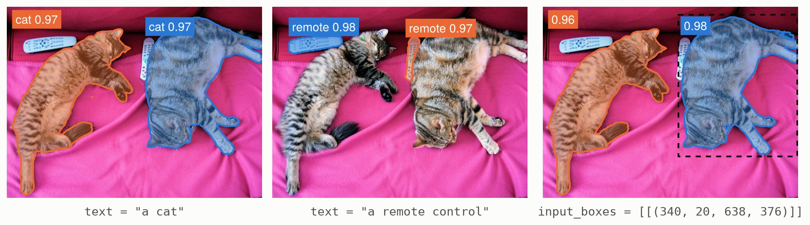

# [Segmenting objects](@id segmentation)

SAM 3, Meta's Segment Anything Model 3, finds and segments the objects of an image that a
prompt describes: a short text, such as "a cat", or boxes around examples of the objects.
Metalhead ports the detector of transformers' SAM 3 and its processor, which prepares the
images and prompts, and turns the outputs of the model into scores, boxes and masks.



*SAM 3.1 on a [photograph of COCO](http://images.cocodataset.org/val2017/000000039769.jpg),
prompted with two texts and with a box (dashed), at a threshold of 0.5. A box is an example:
SAM 3 finds the objects like it, here both cats.*

## Set up

```julia
using Pkg
Pkg.add(["Metalhead", "FileIO", "ImageIO", "ImageCore", "HuggingFaceTokenizers"])
```

```julia
using Metalhead, FileIO, ImageCore, HuggingFaceTokenizers
using Metalhead.Transformers: post_process_instance_segmentation
using Downloads: download

model = create_model("unsloth/sam3.1"; pretrained = true)   # SAM 3.1; SAM 3: "jetjodh/sam3"
proc = create_processor("unsloth/sam3.1")
```

Both repositories are ungated: `jetjodh/sam3` holds the same weights as Meta's gated
`facebook/sam3`. Only the detector of SAM 3's video model is ported, not its tracker of
objects across the frames of a video. Prompts need the tokenizer of the repository, which
`create_processor` loads after `using HuggingFaceTokenizers`; without it, the processor
prepares the images only.

## Text prompts

The processor resizes the image to the 1008 × 1008 pixels of the model, and pads the prompt
to 32 tokens:

```julia
img = load(download("http://images.cocodataset.org/val2017/000000039769.jpg"))   # 640 × 480
inputs = proc(; images = img, text = "a cat")
size(inputs.pixel_values)      # (1008, 1008, 3, 1)
outputs = model(inputs)
```

[`post_process_instance_segmentation`](@ref Metalhead.Transformers.post_process_instance_segmentation)
keeps the objects whose score is above `threshold`, with their boxes and masks at the size of
the image, `target_sizes`:

```julia
objects = only(post_process_instance_segmentation(proc, outputs; threshold = 0.5,
    target_sizes = inputs.original_sizes))
objects.scores                 # [0.965, 0.970]
objects.boxes                  # 4 × 2: the (x1, y1, x2, y2) of each cat, in pixels
size(objects.masks)            # (640, 480, 2): width × height × objects
```

The score of an object is the probability of its query times that of the presence of the
prompt in the image.
[`post_process_object_detection`](@ref Metalhead.Transformers.post_process_object_detection)
returns the scores and boxes only, and
[`post_process_semantic_segmentation`](@ref Metalhead.Transformers.post_process_semantic_segmentation)
a single mask of the objects of each image, with its probabilities.

A vector of images makes a batch, with a vector of prompts, one for each image, and the
post-processing returns the objects of each image.

## Box prompts

A box prompt is `(x1, y1, x2, y2)` in the pixels of its image, a vector of them for each
image. A box is an example of the objects to find, not a selection: around the cat on the
right, it finds both cats, with scores of 0.977 and 0.960.

```julia
inputs = proc(; images = img, input_boxes = [[(340, 20, 638, 376)]])
objects = only(post_process_instance_segmentation(proc, model(inputs); threshold = 0.5,
    target_sizes = inputs.original_sizes))
```

Without text, boxes have the text "visual", as in transformers, and they combine with a text
too. `input_boxes_labels` labels each box as a positive example (1, the default) or a
negative one (0). See [`Sam3Processor`](@ref Metalhead.Transformers.Sam3Processor) for the
inputs it takes and the arrays it returns.

## On a GPU

Move the model and its inputs to the GPU; `original_sizes` stays on the CPU, for the
post-processing:

```julia
using CUDA, cuDNN

device = gpu_device()
model = device(model)
outputs = model(device(inputs))
```
