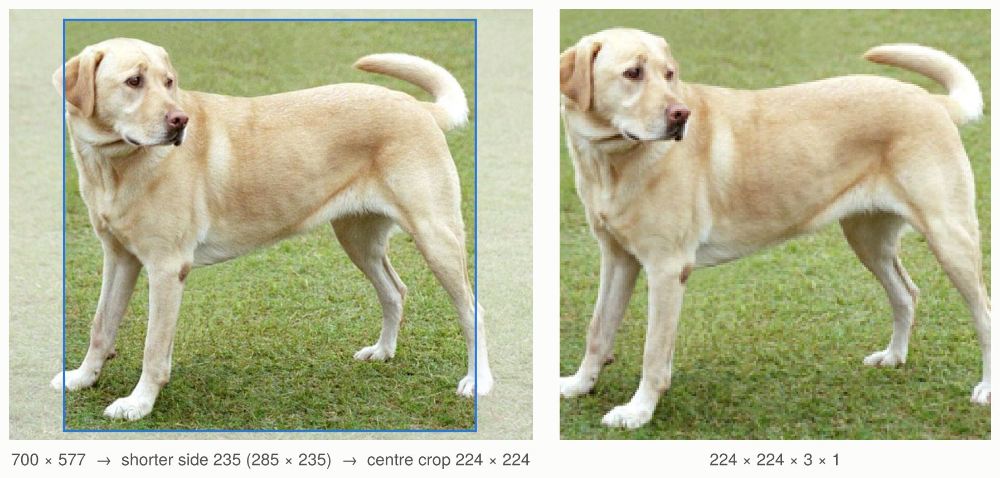
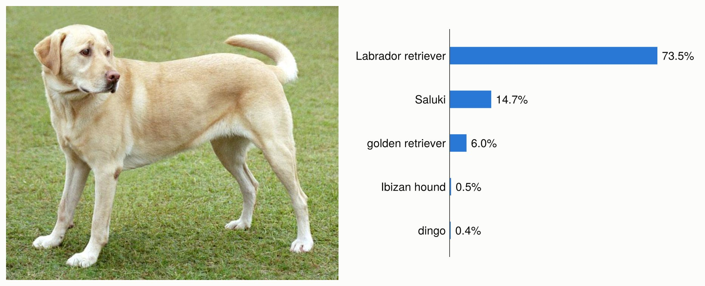
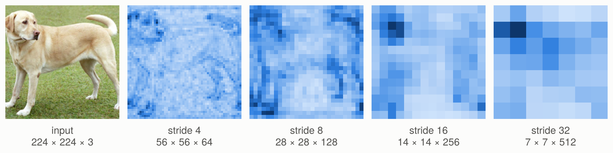
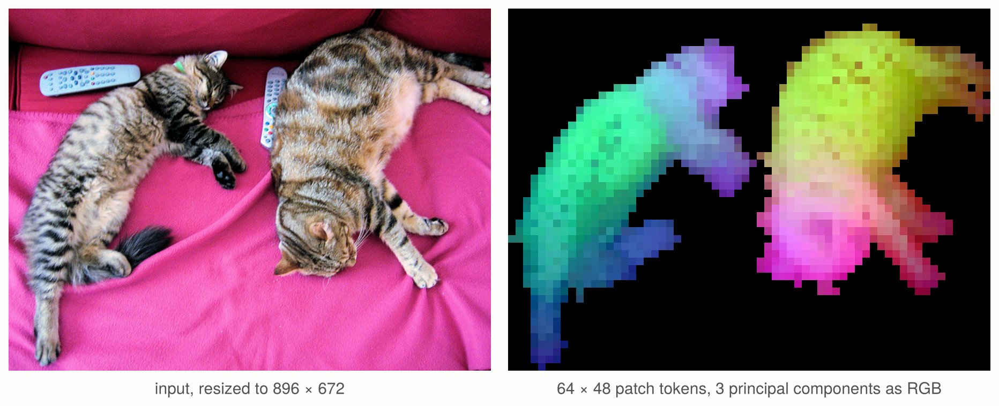

# [Working with vision models](@id vision_models)

This tutorial uses a pretrained ResNet to classify a photograph, extract image features,
and learn a classifier for your own images. It then shows how to fine-tune the backbone
and how a vision transformer's features differ from a convolutional network's.

Run the Julia blocks in order. The first model load downloads weights from the Hugging Face
Hub; later loads use the cache. The dataset sections use your own photographs.

## Set up

Install the packages of this tutorial in its Julia environment:

```julia
using Pkg
Pkg.add(["Metalhead", "Flux", "FileIO", "ImageIO", "ImageCore"])
```

```julia
using Metalhead, Flux
using FileIO, ImageIO, ImageCore
using Downloads: download
using Random: seed!, shuffle!
using Statistics: mean

seed!(42)
repo = "timm/resnet18.a1_in1k"
model = create_model(repo)
transform = create_processor(repo)
```

ResNet-18 is a convolutional neural network (CNN). Its successive stages reduce the spatial
resolution and increase the number of feature channels. Global pooling turns the last feature
map into one vector per image, and a linear classifier maps that vector to class scores.
This checkpoint was trained for ImageNet's 1,000 classes. The [model list](@ref models)
links to its checkpoint and to other ported architectures.

## Prepare a photograph

An image loaded by FileIO is a height × width matrix of colours. A Metalhead vision model
takes a width × height × channels × batch array, prepared as the checkpoint was evaluated:
resized, cropped and normalised. `transform`, the processor of the checkpoint, does both:
it is timm's eval transform, with the settings of the checkpoint's configuration, which
`show` prints with their source:

```julia
transform
# EvalTransform
#   input_size = (3, 224, 224)    config.json
#   interpolation = "bicubic"     config.json
#   mean = (0.485, 0.456, 0.406)  config.json
#   std = (0.229, 0.224, 0.225)   config.json
#   crop_pct = 0.95               config.json
#   crop_mode = "center"          config.json

photo_url = "https://upload.wikimedia.org/wikipedia/commons/2/26/YellowLabradorLooking_new.jpg"
img = load(download(photo_url))
x = transform(img)
size(x)                        # (224, 224, 3, 1)
```

`input_size` is in PyTorch order: channels, height, width. The transform resizes the shorter
side of the image to `floor(224 / 0.95) = 235` pixels with Pillow's bicubic filter, crops
224 × 224 pixels from the centre, scales the values to [0, 1] and normalises each channel
with `mean` and `std`. The result is the input that timm computes from the same pixels as a
PIL image, bit for bit, so that scores reproduce those of timm. (A JPEG decoded by ImageIO
can differ slightly from Pillow's decoding of it.)



*The [example photograph](https://commons.wikimedia.org/wiki/File:YellowLabradorLooking_new.jpg),
with the region that the transform keeps outlined, and the input of the model, `x`, with its
normalisation undone. The getting started guide classifies the same photograph.*

With ImageCore loaded, the transform turns the matrix of colours into the width × height ×
channels array that it works on, and the last dimension of `x` is a batch of one image. An
array of that layout, of `UInt8` from 0 to 255 or of reals from 0 to 1, works without
ImageCore.

## Classify the image

Models returned by `create_model` are in test mode: dropout is disabled and batch
normalisation uses the stored statistics. A classifier returns logits, one column per image.
Apply softmax over the class dimension to obtain probabilities:

```julia
logits = model(x)
size(logits)                   # (1000, 1)
probabilities = softmax(logits; dims = 1)

labels_url = "https://raw.githubusercontent.com/pytorch/hub/master/imagenet_classes.txt"
imagenet_labels = readlines(download(labels_url))
top5 = sortperm(vec(probabilities); rev = true)[1:5]
[(; label = imagenet_labels[i], probability = probabilities[i, 1]) for i in top5]
# Labrador retriever 0.735, Saluki 0.147, golden retriever 0.060, Ibizan hound 0.005, ...
```



*The five most probable of the 1,000 ImageNet classes for the photograph, by
`timm/resnet18.a1_in1k`.*

Those labels match this checkpoint's ImageNet class order. When using a different dataset
or checkpoint, use its label order. Softmax scores describe the model's prediction over
its classes; an image from a new class still receives one of these labels.

To classify a batch, pass a vector of photographs, of any sizes:

```julia
images = [img, reverse(img; dims = 2)]
xbatch = transform(images)
size(model(xbatch))            # (1000, 2)
```

## Extract features

The same backbone can supply features to a new task. The interface separates the spatial
features, the pooled embedding and the classifier:

```julia
spatial = forward_features(model, x)
embedding = forward_head(model, spatial; pre_logits = true)
reconstructed_logits = forward_head(model, spatial)

size(spatial)                  # (7, 7, 512, 1)
size(embedding)                # (512, 1)
reconstructed_logits ≈ logits  # true
```

Each column of `embedding` represents an entire image. A linear classifier can learn from
these vectors while the backbone stays fixed. Spatial features preserve the image grid
and are useful when a task needs positions as well as an image-level representation.

### Train a classifier on your images

Arrange your labelled photographs into separate training and validation directories, with
one subdirectory per class. For example:

```text
data/
  train/
    daisy/
      image1.jpg
      ...
    rose/
      image2.jpg
      ...
  val/
    daisy/
      ...
    rose/
      ...
```

Use different photographs in the two splits. The following helpers load JPEG or PNG files
and build batches with a consistent class order:

```julia
function image_samples(root, classes)
    return [(; path = joinpath(root, label, file), label)
            for label in classes for file in sort(readdir(joinpath(root, label)))
            if lowercase(splitext(file)[2]) in (".jpg", ".jpeg", ".png")]
end

function image_batch(samples, transform, classes)
    x = transform([load(sample.path) for sample in samples])
    y = Flux.onehotbatch([sample.label for sample in samples], classes)
    return x, y
end

function embed_images(model, samples, transform, classes; batchsize = 8)
    isempty(samples) && error("No images found")
    chunks = map(collect(Iterators.partition(samples, batchsize))) do batch
        x, _ = image_batch(batch, transform, classes)
        return forward_head(model, forward_features(model, x); pre_logits = true)
    end
    y = Flux.onehotbatch([sample.label for sample in samples], classes)
    return reduce(hcat, chunks), y
end

train_root, val_root = "data/train", "data/val"
classes = sort(filter(name -> isdir(joinpath(train_root, name)), readdir(train_root)))
train_samples = image_samples(train_root, classes)
val_samples = image_samples(val_root, classes)
train_z, train_y = embed_images(model, train_samples, transform, classes)
val_z, val_y = embed_images(model, val_samples, transform, classes)
```

Keep the backbone in test mode while computing these embeddings. Caching the vectors means
the training loop only runs the new classifier; it does not repeatedly run the images through
ResNet. This is often called a *linear probe*:

```julia
head = Dense(size(train_z, 1) => length(classes))
loader = Flux.DataLoader((train_z, train_y); batchsize = 32, shuffle = true)
opt_state = Flux.setup(Adam(1e-3), head)
classification_loss(m, x, y) = Flux.logitcrossentropy(m(x), y)

for epoch in 1:10
    Flux.train!(classification_loss, head, loader, opt_state)
    predicted = Flux.onecold(head(val_z), classes)
    expected = Flux.onecold(val_y, classes)
    validation_accuracy = mean(predicted .== expected)
    @info "Linear probe" epoch validation_accuracy
end
```

`logitcrossentropy` takes logits directly. The targets use the same `classes` order for
training, validation and prediction. Only `head` is passed to the optimiser, so the pretrained
backbone's weights stay fixed. See the
[Flux training guide](https://fluxml.ai/Flux.jl/v0.16/guide/training/training/) for training
loops, optimiser state and data loaders.

### Fine-tune the backbone

To adapt the representation as well, create a pretrained model with a new classifier.
Changing `num_classes` loads the backbone weights and initialises a classifier of the right
size. Here the model is ResNet-18, whose classifier is the `fc` field, so we can copy in the
linear probe we just trained:

```julia
tuned = create_model(repo; num_classes = length(classes))
Flux.loadmodel!(tuned.fc, Flux.state(head))
Flux.trainmode!(tuned)
opt_state = Flux.setup(Adam(1e-5), tuned)

for epoch in 1:3
    shuffle!(train_samples)
    for batch in Iterators.partition(train_samples, 8)
        xb, yb = image_batch(batch, transform, classes)
        Flux.train!(classification_loss, tuned, [(xb, yb)], opt_state)
    end
end

Flux.testmode!(tuned)
xb, _ = image_batch(val_samples[1:1], transform, classes)
Flux.onecold(tuned(xb), classes)
```

Fine-tuning uses image batches, because gradients must flow through the backbone. Switching
to train mode enables dropout and batch-normalisation updates; switch back to test mode for
validation and inference. Classifier field names differ between model families, so inspect
the model before copying a head from another architecture.

The examples run on the CPU. To train on a GPU, move the model and every input and target
batch to the same device before setting up its optimiser; see the
[Flux GPU guide](https://fluxml.ai/Flux.jl/stable/guide/gpu/).

## Use a backbone for dense prediction

Segmentation and detection heads commonly combine features at several resolutions.
`feature_info` describes the taps, and `forward_intermediates` returns their tensors:

```julia
info = feature_info(model)
maps = forward_intermediates(model, x; indices = 2:5, intermediates_only = true)
[(; channels = f.num_chs, reduction = f.reduction, shape = size(y))
 for (f, y) in zip(info[2:5], maps)]
```

For ResNet-18 and a 224 × 224 input, these maps have shapes 56 × 56 × 64 × batch,
28 × 28 × 128 × batch, 14 × 14 × 256 × batch and 7 × 7 × 512 × batch. They are backbone
features; segmentation or detection needs a task-specific head and training data.



*The four maps of ResNet-18 for the photograph: at each position, the norm of its feature
vector, from light (small) to dark (large), each map on its own scale. Each map has half the
width and height of the previous one, and twice its channels.*

Collections of `indices` use 1-based positions in `feature_info`. An integer `k` selects
the last `k` taps. Use `stop_early = true` to stop at the last requested tap. The
[getting started guide](@ref quickstart) lists the supported families and their tap conventions.

## Vision transformers return tokens

A vision transformer (ViT) divides the image into patches and processes a sequence of
patch embeddings. Its `forward_features` returns channels × tokens × batch, rather than a
CNN's spatial grid. This randomly initialised tiny ViT illustrates the shapes:

```julia
vit = create_model("vit_tiny_patch16_224")
tokens = forward_features(vit, x)
size(tokens)                   # (192, 197, 1): 196 patches and one class token

grid = only(forward_intermediates(vit, x; indices = 1, norm = true,
    intermediates_only = true))
size(grid)                     # (14, 14, 192, 1)
```

`forward_intermediates` removes prefix tokens when it reshapes patches into a spatial map.
With `output_fmt = "NLC"` it keeps patch tokens as channels × tokens × batch; with
`return_prefix_tokens = true` it also returns the prefix tokens separately. The integer
`indices = 1` above selects the last transformer block.

For useful pretrained embeddings, load a ViT checkpoint, `create_model(repo)`, and prepare
its images with its processor, `create_processor(repo)`. DINOv2, CLIP and SigLIP variants
have different pooling and prefix-token conventions; `forward_head(...; pre_logits = true)`
applies the model's own pooling to its final features.

### The patch features of DINOv2

DINOv2, trained without labels, gives patch features that tell objects and their parts
apart. With `dynamic_img_size = true`, a ViT takes images of any size that is a multiple of
its patch size. Here a photograph of 640 × 480 pixels is resized to 896 × 672, which
DINOv2's patches of 14 pixels cut into a grid of 64 × 48:

```julia
using LinearAlgebra: svd

repo = "timm/vit_small_patch14_reg4_dinov2.lvd142m"
dinov2 = create_model(repo; dynamic_img_size = true)
transform = create_processor(repo; input_size = (3, 672, 896))   # channels, height, width

cats = load(download("http://images.cocodataset.org/val2017/000000039769.jpg"))
y = only(forward_intermediates(dinov2, transform(cats); indices = 1, norm = true,
    intermediates_only = true))       # 64 × 48 × 384 × 1
X = reshape(y, :, size(y, 3))         # 3072 patches × 384 features
X = X .- sum(X; dims = 1) ./ size(X, 1)
pcs = X * svd(X).V[:, 1:3]            # the first three principal components of each patch
```



*The patch features of DINOv2 for a
[photograph of COCO](http://images.cocodataset.org/val2017/000000039769.jpg). The first
principal component separates the cats from the background, in black; the first three
components of the patches of the cats, as red, green and blue, show their parts. The code of
this figure and the others is in
[`docs/figures/make_figures.jl`](https://github.com/FluxML/Metalhead.jl/blob/master/docs/figures/make_figures.jl).*
